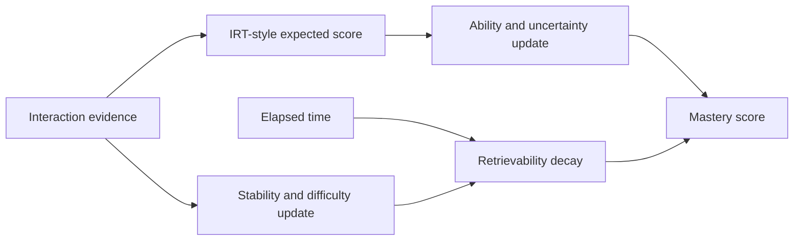

# Adaptive Mastery Engine

[](https://github.com/evlo-malik/adaptive-mastery-engine/actions/workflows/ci.yml)
[](LICENSE)
[](tsconfig.json)

A framework-independent TypeScript engine for estimating skill mastery from practice answers, exams, and flashcard reviews. It combines item-response scoring, uncertainty-aware updates, and memory decay in one serializable state model.

The package has no runtime dependencies, stores no data, and makes no network requests. Use it in a browser, API, worker, or mobile JavaScript runtime.

> [!IMPORTANT]
> This is an experimental scoring model, not a validated psychometric instrument. Calibrate its constants against your own outcomes before using scores for consequential decisions.

## Why this exists

Simple progress counters treat every answer alike and forget that memories fade. Adaptive Mastery Engine tracks four signals instead:

- ability, updated from correctness and item difficulty;
- uncertainty, reduced as evidence accumulates;
- memory stability, updated after each review;
- retrievability, decayed as time passes.

The public score is `ability potential × current retrievability`, mapped to a 1–100 range.

## Quick start

```bash
npm install
npm run build
```

```ts
import { MasteryService } from "adaptive-mastery-engine";

const initial = MasteryService.createDefaultState();
const result = MasteryService.processInteraction(initial, {
  type: "practice",
  correct: true,
  questionType: "MCQ",
  userConfidence: 0.7,
  difficulty: 55,
});

console.log(result.newScore, result.delta);
persist(result.state);
```

Persist the returned state after every interaction. Restore `lastSeenAt` as a `Date` when loading JSON.

## Supported evidence

### Practice questions

Practice updates support true/false, multiple-choice, and long-form questions. Long-form questions can provide `score` and `totalMarks` for partial credit.

```ts
MasteryService.processInteraction(state, {
  type: "practice",
  correct: true,
  questionType: "LONG",
  userConfidence: 0.6,
  score: 7,
  totalMarks: 10,
});
```

### Exams

An exam submits a batch of question outcomes as one stronger signal.

```ts
MasteryService.processInteraction(state, {
  type: "exam",
  questions: [
    { correct: true, questionType: "MCQ", difficulty: 60 },
    { correct: false, questionType: "LONG", difficulty: 75 },
  ],
});
```

### Flashcards

Flashcard grades use the familiar four-level review scale: fail, hard, good, and easy.

```ts
MasteryService.processInteraction(state, {
  type: "flashcard",
  grade: 3,
});
```

## Model



The implementation draws ideas from Glicko-style uncertainty, three-parameter item response theory, and FSRS-style memory stability. It deliberately uses practical caps and response-type weights, so it is a hybrid product model rather than a reference implementation of any one paper.

See [`src/constants.ts`](src/constants.ts) for every tunable parameter and [`src/types.ts`](src/types.ts) for the state contract.

## Development

```bash
npm install
npm run check
npm run lint
npm test
npm run build
```

Tests exercise update direction, partial credit, score bounds, decay, and malformed persisted state. See [CONTRIBUTING.md](CONTRIBUTING.md) before proposing model changes.

## Limitations

- Default parameters have not been calibrated against a public learner dataset.
- A single state represents one person–skill pair; hierarchy and transfer belong in the calling application.
- Question difficulty self-calibration is intentionally conservative.
- The engine provides estimates, not grades, diagnoses, or admission decisions.

## License

[MIT](LICENSE)
